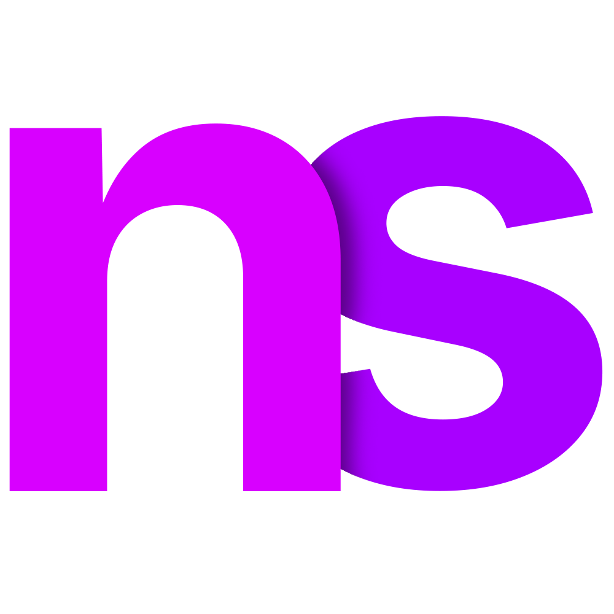

<p align="center">
  
</p>

# Neuro Studio

Neuro Studio is the desktop app for the Ohm Lab Neuro N6 AI development board
(STM32N6). It shows the board's live camera stream with inference overlays,
and a panel for each sensor on the board. It is built with Electron, React,
TypeScript and Vite, and runs on Windows, macOS and Linux.

## Download

Installers are on the [Releases](../../releases/latest) page. Each link below
always fetches the latest release.

| Platform | File | Install |
| --- | --- | --- |
| Windows 10 or later | [`Neuro-Studio-Setup.exe`](../../releases/latest/download/Neuro-Studio-Setup.exe), 116 MB | Run it. It installs for your user, with Start menu and desktop shortcuts, and uninstalls from Settings, Apps. [`Neuro-Studio-Portable.exe`](../../releases/latest/download/Neuro-Studio-Portable.exe) runs without installing. |
| macOS 12 or later, Apple Silicon or Intel | [`Neuro-Studio.dmg`](../../releases/latest/download/Neuro-Studio.dmg), 231 MB | Open it and drag Neuro Studio to Applications. |
| Ubuntu, Debian and derivatives | [`neuro-studio_amd64.deb`](../../releases/latest/download/neuro-studio_amd64.deb), 105 MB | `sudo apt install ./neuro-studio_amd64.deb`, which also installs the board's udev rule. |
| Other Linux | [`Neuro-Studio-x86_64.AppImage`](../../releases/latest/download/Neuro-Studio-x86_64.AppImage), 126 MB | Make it executable and run it. Install the udev rule as below. |

### First launch

The installers are not signed with paid certificates yet, so Windows and macOS
ask you to confirm Neuro Studio once. After that it opens like any other app.

**macOS 12 or later**

1. Open `Neuro-Studio.dmg` and drag Neuro Studio to Applications.
2. Open Neuro Studio from Applications. macOS says it cannot verify the app.
   Close the message with **Done**, **OK** or **Cancel**, whichever it shows,
   not **Move to Trash**.
3. Open **System Settings**, then **Privacy & Security** (on macOS 12, **System
   Preferences**, then **Security & Privacy**, then **General**). Near the
   bottom it says Neuro Studio was blocked. Click **Open Anyway**. If the
   button is not there, open Neuro Studio once more and come back: it shows
   for about an hour after a blocked launch.
4. Confirm with **Open Anyway** or **Open**, and with your password or Touch ID
   if asked. Neuro Studio opens.

On macOS 15 or later, the first time Neuro Studio connects to a board over
WiFi or Ethernet, macOS asks whether it may find devices on your local network.
Click **Allow**: without it, Neuro Studio cannot reach the board. You can
change this later under **Privacy & Security**, **Local Network**.

If macOS instead says Neuro Studio "is damaged and can't be opened", run this
in Terminal, then open it again:

```bash
xattr -dr com.apple.quarantine "/Applications/Neuro Studio.app"
```

**Windows**

Code signing for Windows is being set up and will come in a later release.
Until then the installers are unsigned, so Windows may say "Windows protected
your PC": click **More info**, then **Run anyway**.

Neuro Studio checks GitHub for a newer release once per launch and offers to
open its page. It updates nothing itself.

## Features

- Live camera over USB, WiFi (the network the board hosts) or Ethernet, with
  snapshots and MJPEG recording.
- Inference overlays: detection boxes, instance masks, keypoints and
  skeletons, and class labels.
- Sensor panels: ToF depth grid, FLIR Lepton thermal view with colour maps and
  temperature probes, magnetometer and IMU plots, and a device terminal.
- Tuning: ISP controls (white balance, colour matrix, black level, sharpness,
  gamma), manual exposure, and sliders for any parameter a sketch exposes,
  with "copy as code".
- Vision, classifiers and events: QR codes, barcodes, colour blobs and
  AprilTags with pose, the image classifier's best classes, the audio
  classifier's scores and spectrogram, and events the board records.
- Microphone playback on the computer.
- Bootloader tool: flashes a firmware `.bin` over USB, verified by CRC.
- WiFi setup: stores on the board, over USB, the network it joins or hosts,
  WPA2 or WPA3 only, and its link key. A hosted network can keep the board's
  own password.
- Several boards: a window per board, each picked by USB port.

## Running from source

Requires [Node.js](https://nodejs.org/) 22.12 or later.

```bash
npm install
npm run dev
```

A board plugged in over USB is found automatically. WiFi and Ethernet are
selected from the connection menu in the status bar.

### Platforms

- Windows: no driver needed. Firmware still on the legacy USB identity
  (`CAFE:4013`) needs the WinUSB driver, installed once with
  [Zadig](https://zadig.akeo.ie/).
- macOS: no driver needed.
- Linux: the udev rule lets a user open the board. The .deb installs it. For
  the AppImage or a source checkout, install it, then replug the board:

  ```bash
  sudo cp packaging/linux/60-neuro-n6.rules /etc/udev/rules.d/
  sudo udevadm control --reload-rules && sudo udevadm trigger
  ```

  Packaged builds also include the rule in their `resources` folder.

### Network connections

The board serves the same stream on TCP port 5000.

| Connection | Address                                                            |
| ---------- | ------------------------------------------------------------------ |
| WiFi       | the one the board announces over USB, else `192.168.10.1:5000`     |
| Ethernet   | `192.168.20.1:5000`, with the computer's port at `192.168.20.2/24` |

A board streams over WiFi only on the network it hosts. A board that joins
another network streams over USB only.

Connect the board over USB first, then pick WiFi: the connect help shows the
name and password of the network the board hosts, the password hidden until
you ask, with a Copy button. Neuro Studio keeps them in memory only. The
example sketches also print both on the Serial Monitor.

The stream is not encrypted. A board with a link key (`WiFi.setLinkKey()`)
streams only to a host that knows the key, and Neuro Studio asks for it.

When a board on its own WiFi network resets, Neuro Studio reconnects as soon
as the computer is back on that network. Windows can take a minute to rejoin
on its own; picking the network again in its WiFi menu rejoins at once.

### Network-only mode

Listing USB devices sends requests to every device on the bus. With
`--network-only`, or `NEURO_STUDIO_NETWORK_ONLY=1`, which also applies to
`npm run dev`, Neuro Studio never loads libusb: it lists no USB boards,
disables the bootloader tool and the WiFi settings, and starts on WiFi SoftAP.
`--wifi-host=<address>` and `--wifi-port=<port>`, or `NEURO_STUDIO_WIFI_HOST`
and `NEURO_STUDIO_WIFI_PORT`, set the SoftAP address, in place of the one the
board announces over USB or `192.168.10.1:5000`.

```bash
npm run build
npx electron . --network-only
```

## Development

| Command                | Action                                                   |
| ---------------------- | -------------------------------------------------------- |
| `npm run dev`          | Run the app with hot reload                              |
| `npm test`             | Unit tests (Vitest)                                      |
| `npm run lint`         | ESLint                                                   |
| `npm run typecheck`    | TypeScript                                               |
| `npm run format`       | Prettier                                                 |
| `npm run build`        | Type-check and build the renderer into `dist/`           |
| `npm run package`      | Build, then package installers for this OS in `release/` |
| `npm run smoke`        | Run the packaged app against a fake board and check it   |

`test/replay.test.ts` replays board captures through the app's ingest and
device store. Captures are kept outside the repository: `NEURO_STUDIO_CAPTURES`
names a folder of `<name>.bin` files, the bytes as received, and `<name>.json`
files, with each read's length and time, the commands sent and what was
observed. Without it those tests are skipped. A capture taken over USB from a
board that hosts a WiFi network holds that network's password.

`test/live.test.ts` runs the same session, store and recorder against a board
on the network: streaming, the Terminal, commands, a 10 s recording and a
reconnect. It never loads libusb. Join the board's network, then:

```bash
NEURO_STUDIO_LIVE=192.168.10.1:5000 npx vitest run test/live.test.ts
```

`NEURO_STUDIO_LIVE_KEY` gives a link key, `NEURO_STUDIO_LIVE_RECORDING` keeps
the recording at a path, and `NEURO_STUDIO_LIVE_WATCH_S` follows the link for
that many seconds while the board is reset.

`npm run smoke` runs the unpacked app from `release/` against a fake board on
localhost; `npm run smoke -- --install` installs the installer first and
uninstalls it after. The app runs with `--network-only`, so no USB device is
touched.

Each platform's installers are built on that platform. The release workflow
builds, tests and smoke-tests all three, and signs them once signing is set
up: see [docs/RELEASING.md](docs/RELEASING.md). The native modules, `usb` and
`serialport`, ship prebuilt binaries for every platform.

### Layout

| Path | Contents |
| --- | --- |
| `electron/main.cjs` | windows, IPC, recording, the bootloader tool's IPC |
| `electron/preload.cjs` | the `window.neuro` bridge to the renderer |
| `electron/device/` | USB and TCP transport, the vendor frame parser |
| `electron/dfu/` | the bootloader (DFU) protocol and flashing |
| `src/device/` | TLV decoding, host-to-device packets |
| `src/state/` | stores for device data, UI options and panel settings |
| `src/render/` | canvas overlays, thermal and camera alignment |
| `src/components/` | the app shell, camera stage and panels |
| `test/` | unit tests |
| `scripts/` | the installer smoke test and the release check |
| `docs/protocol.md` | the wire protocol between the app and the board |
| `docs/RELEASING.md` | making a release, and setting up signing |
| `packaging/` | the Linux udev rule |
| `electron-builder.cjs` | packaging and signing for Windows, macOS and Linux |
| `branding/` | logo artwork |

## Contributing

CI runs `npm run lint`, `npm run format:check`, `npm run build` and `npm test`
on Windows, macOS and Linux for every pull request. A change to the wire
format updates [docs/protocol.md](docs/protocol.md) in the same pull request.

## License

Neuro Studio is free software, released under the
[GNU General Public License, version 3 only](LICENSE). Third-party
components shipped with the app are listed in
[THIRD-PARTY-NOTICES.md](THIRD-PARTY-NOTICES.md), and each binary release
corresponds to the source at its release tag.

Inter and JetBrains Mono are bundled under the SIL Open Font License; the
licence texts are in `public/fonts/`.
